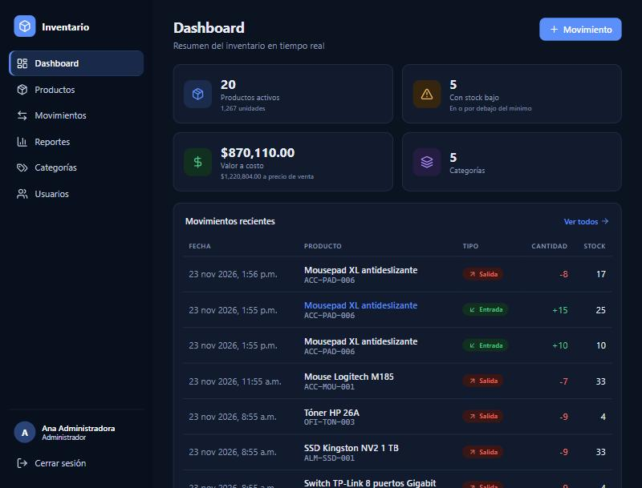
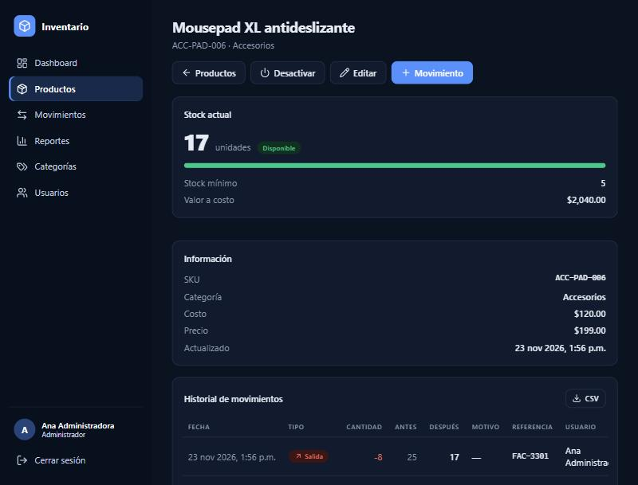
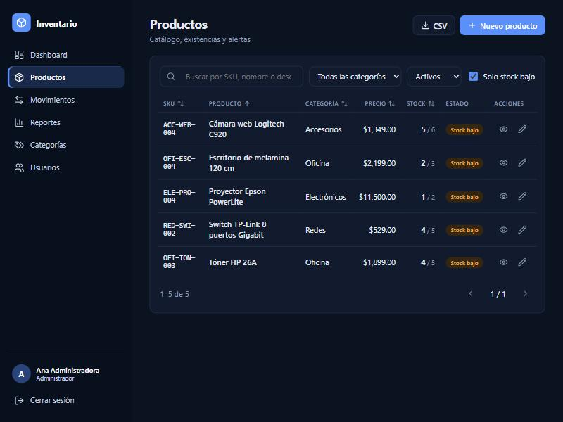
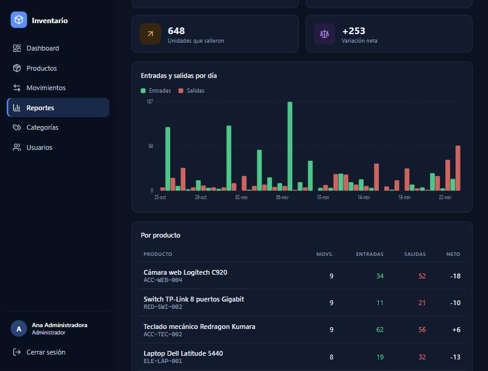
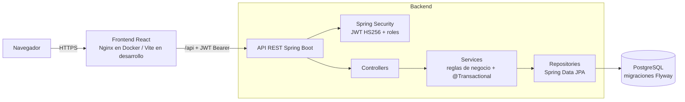
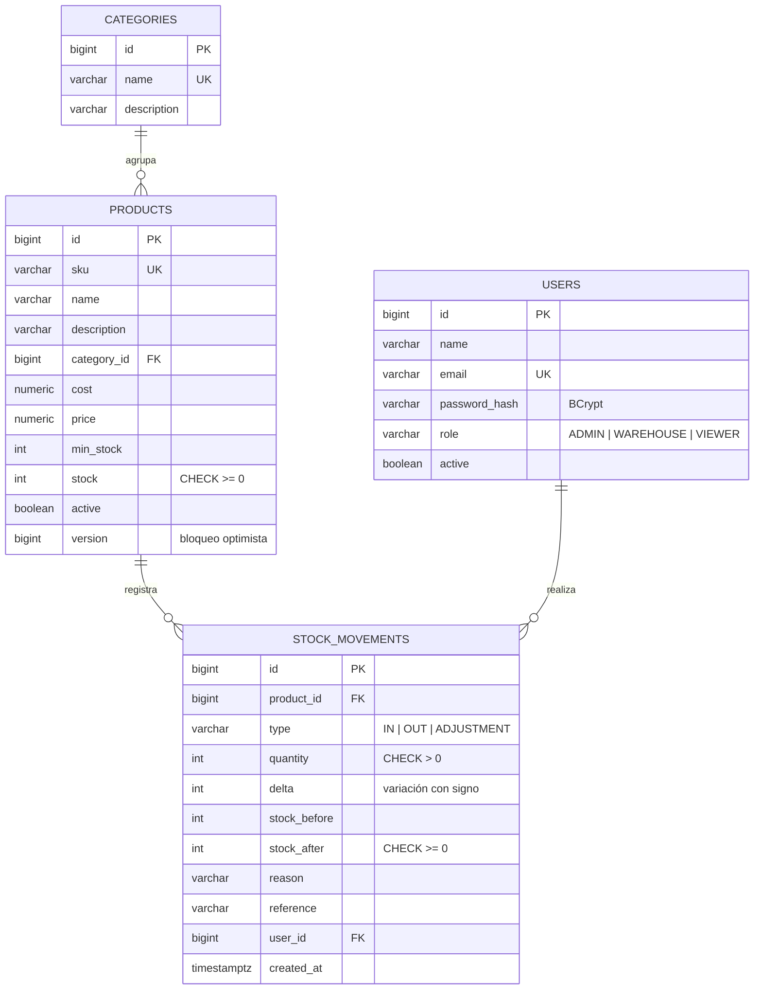

# Sistema de Inventario

Aplicación web full-stack para administrar productos, existencias y movimientos de almacén.
Controla **qué** productos hay, **cuántas** unidades existen y **cómo** cambia el stock, con un historial
auditable de cada entrada, salida y ajuste, y alertas cuando un producto llega a su nivel mínimo.

> El valor del proyecto no está en la tabla de productos, sino en la **consistencia del stock** y la
> **trazabilidad** de cada movimiento: el stock solo cambia mediante movimientos, en una sola transacción,
> y nunca puede quedar negativo.

**Stack:** Java 17/21 · Spring Boot 3.3 · Spring Security (JWT) · Spring Data JPA · Flyway · PostgreSQL / H2 ·
React 18 + TypeScript + Vite · Docker Compose · GitHub Actions

---

## Funcionalidades

- **Inicio de sesión y roles**: Administrador, Encargado de almacén y Consulta (solo lectura).
- **Dashboard**: productos activos, unidades, valor del inventario a costo y a precio de venta, productos con
  stock bajo y movimientos recientes.
- **Productos**: alta, detalle, edición, desactivación y reactivación (baja lógica). SKU único, categoría,
  costo, precio, stock mínimo y stock inicial opcional.
- **Búsqueda, filtros, ordenamiento y paginación** (por SKU/nombre/descripción, categoría, estado y stock bajo).
- **Movimientos**: entrada, salida y ajuste (aumento/disminución) con cantidad, motivo, referencia, fecha y usuario.
  Cada movimiento guarda el stock anterior y el resultante.
- **Reportes**: resumen por periodo, por producto y por tipo de movimiento, gráfica diaria de entradas/salidas,
  listado de productos bajo el mínimo con costo de reposición.
- **Exportación CSV** de productos y movimientos (respeta los filtros; compatible con Excel).
- **Categorías** y **usuarios** administrables.
- **API documentada** con Swagger/OpenAPI y colección de Postman con casos de éxito y error.

## Capturas

| Dashboard | Detalle de producto |
|---|---|
|  |  |

| Productos con filtro de stock bajo | Reportes |
|---|---|
|  |  |


---

## Arquitectura



Estructura de paquetes del backend (`com.portafolio.inventario`):

```
config/       Seguridad, OpenAPI, propiedades y carga de datos demo
controller/   Endpoints REST, paginación y ordenamiento permitidos
dto/          Peticiones y respuestas (records) con Bean Validation
entity/       Entidades JPA: Product, Category, StockMovement, User
exception/    Errores de negocio y manejador global con formato uniforme
mapper/       Conversión entidad → DTO
repository/   Repositorios y Specifications para filtros dinámicos
security/     Emisión de JWT, usuario actual y respuestas 401/403 en JSON
service/      Lógica de negocio (único punto que modifica stock: StockMovementService)
validation/   Validaciones de varios campos (reglas de ajuste)
```

### Modelo de datos (ERD)



Todas las tablas tienen además `created_at`/`updated_at`. El esquema se crea con Flyway
(`backend/src/main/resources/db/migration`).

---

## Reglas de negocio y cómo se garantizan

| Regla | Implementación |
|---|---|
| El SKU no se puede repetir | Validación en servicio (insensible a mayúsculas; se normaliza a mayúsculas) + restricción `UNIQUE` en BD → **409** |
| Cantidad de un movimiento > 0 | Bean Validation en el DTO, revalidación en el servicio y `CHECK (quantity > 0)` → **400** |
| Los ajustes deben explicar el motivo | Validador `@ValidMovement` (motivo y sentido obligatorios) + revalidación en servicio → **400** |
| Una salida no puede superar el stock | `StockMovementService` lo verifica antes de aplicar; `CHECK (stock >= 0)` como última defensa → **422** |
| Cambio de stock y movimiento en la misma transacción | `@Transactional` en `StockMovementService`; si falla el guardado del movimiento se hace rollback del stock (probado) |
| Movimientos concurrentes no corrompen el saldo | Bloqueo pesimista `SELECT … FOR UPDATE` sobre el producto + columna `version` |
| No se borran movimientos | No existen endpoints `PUT`/`DELETE` para movimientos (**405**); se corrige con un ajuste nuevo |
| El stock no se edita a mano | `PUT /api/products/{id}` ignora el stock; solo cambia mediante movimientos |
| Validación de precios y cantidades en servidor | Bean Validation (`@DecimalMin`, `@Digits`, `@Min`…) + `CHECK` en BD, aunque la UI también valide |
| Productos inactivos | Se conservan con su historial; no admiten nuevos movimientos (**422**) |

### Permisos por rol

| Acción | Administrador | Almacén | Consulta |
|---|:-:|:-:|:-:|
| Ver dashboard, productos, movimientos y reportes; exportar CSV | ✅ | ✅ | ✅ |
| Crear y editar productos | ✅ | ✅ | — |
| Registrar entradas, salidas y ajustes | ✅ | ✅ | — |
| Desactivar / reactivar productos | ✅ | — | — |
| Gestionar categorías | ✅ | — | — |
| Gestionar usuarios | ✅ | — | — |

Los permisos se aplican en el backend con `@PreAuthorize`; la interfaz solo oculta lo que el rol no puede hacer.

---

## API REST

Documentación interactiva: **http://localhost:8080/swagger-ui.html** (botón *Authorize* con el token del login).
Colección de Postman: [`postman/inventario.postman_collection.json`](postman/inventario.postman_collection.json).

| Método | Ruta | Descripción |
|---|---|---|
| POST | `/api/auth/login` | Autenticar y obtener JWT |
| GET | `/api/auth/me` | Usuario autenticado |
| GET | `/api/products` | Listar con `q`, `categoryId`, `active`, `lowStock`, `page`, `size`, `sort` |
| POST | `/api/products` | Crear producto (opcional `initialStock`) |
| GET / PUT / DELETE | `/api/products/{id}` | Consultar, modificar o desactivar |
| PATCH | `/api/products/{id}/activate` | Reactivar |
| POST | `/api/stock-movements` | Registrar entrada, salida o ajuste |
| GET | `/api/stock-movements` | Historial con `productId`, `type`, `from`, `to`, `tz`, `q`, paginación |
| GET | `/api/stock-movements/{id}` | Consultar movimiento |
| GET | `/api/dashboard` | Indicadores del dashboard |
| GET | `/api/reports/low-stock` | Productos bajo el mínimo |
| GET | `/api/reports/movements` | Resumen por periodo, producto, tipo y día |
| GET | `/api/reports/products/export` | CSV de productos |
| GET | `/api/reports/movements/export` | CSV de movimientos |
| GET / POST / PUT / DELETE | `/api/categories[/{id}]` | Categorías |
| GET / POST / PUT | `/api/users[/{id}]` | Usuarios (solo administrador) |

Todas las respuestas de error tienen el mismo formato:

```json
{
  "timestamp": "2026-11-23T19:55:00Z",
  "status": 422,
  "error": "Unprocessable Entity",
  "code": "INSUFFICIENT_STOCK",
  "message": "Stock insuficiente para ACC-PAD-006: disponible 25, solicitado 30",
  "path": "/api/stock-movements"
}
```

Códigos usados: 400 validación · 401 sin sesión o credenciales inválidas · 403 sin permisos · 404 no existe ·
405 operación no permitida · 409 duplicado/conflicto · 422 regla de negocio.

---

## Ejecutar

### Opción A: Docker Compose (PostgreSQL + API + frontend)

Requisitos: Docker Desktop.

```bash
cp .env.example .env        # en Windows: copy .env.example .env  — y edita los valores
docker compose up --build
```

- Aplicación: http://localhost:3000
- API / Swagger: http://localhost:8080/swagger-ui.html

### Opción B: desarrollo local (sin Docker)

Requisitos: **Java 17 o 21** y **Node.js 20+**. No hace falta instalar Maven ni una base de datos:
el wrapper descarga Maven y el perfil `local` usa H2 en memoria (los datos se reinician al detener la API).

1. **Backend** (puerto 8080):

   ```bash
   cd backend
   ./mvnw spring-boot:run          # Windows: .\mvnw.cmd spring-boot:run
   ```

2. **Frontend** (puerto 5173, redirige `/api` al backend), en otra terminal:

   ```bash
   cd frontend
   npm install
   npm run dev
   ```

3. Abre http://localhost:5173.

Para usar PostgreSQL sin Docker, arranca la API con el perfil `prod` y define `DB_URL`, `DB_USERNAME`,
`DB_PASSWORD` y `JWT_SECRET`. Si el backend usa otro puerto, define `VITE_API_PROXY` (p. ej.
`http://localhost:8081`) antes de `npm run dev`.

### Cuentas de demostración

Se crean automáticamente (con 19 productos ficticios y ~60 días de movimientos) cuando la base está vacía.
Contraseña de todas: `Demo1234!` (configurable con `DEMO_PASSWORD`).

| Email | Rol |
|---|---|
| `admin@demo.local` | Administrador |
| `almacen@demo.local` | Encargado de almacén |
| `consulta@demo.local` | Consulta |

### Variables de entorno

| Variable | Descripción | Valor por defecto |
|---|---|---|
| `SPRING_PROFILES_ACTIVE` | `local` (H2) o `prod` (PostgreSQL) | `local` |
| `DB_URL`, `DB_USERNAME`, `DB_PASSWORD` | Conexión a PostgreSQL (perfil `prod`) | — |
| `JWT_SECRET` | Clave HMAC para firmar tokens (≥ 32 caracteres) | solo para desarrollo |
| `JWT_EXPIRATION_MINUTES` | Vigencia del token | `480` |
| `CORS_ALLOWED_ORIGINS` | Orígenes permitidos, separados por coma | `http://localhost:5173` |
| `SEED_DEMO_DATA` | Cargar datos ficticios si la base está vacía | `true` |
| `DEMO_PASSWORD` | Contraseña de las cuentas demo | `Demo1234!` |
| `PORT` | Puerto de la API | `8080` |

Ver [`.env.example`](.env.example). No se versionan secretos: `.env` está en `.gitignore`.

---

## Pruebas

```bash
cd backend
./mvnw test                     # Windows: .\mvnw.cmd test
```

27 pruebas automatizadas (JUnit 5, Mockito, MockMvc sobre H2):

- **Unitarias** (`StockMovementServiceTest`, `CsvWriterTest`): cálculo de entradas, salidas y ajustes; rechazo de
  salidas mayores al stock sin modificar nada; cantidades inválidas; productos inactivos; escape de CSV.
- **Integración** (`InventoryApiIntegrationTest`), que cubren las pruebas de aceptación de la guía:
  - crear producto válido y rechazar SKU duplicado;
  - una entrada aumenta el stock y una salida lo disminuye; rechazo de una salida mayor al stock;
  - **un movimiento fallido no deja el stock modificado** (se simula un fallo al guardar y se verifica el rollback);
  - filtros, búsqueda, ordenamiento, paginación y parámetros inválidos;
  - roles: consulta solo lee, almacén no desactiva, acceso sin token o con token alterado (401/403);
  - alertas de stock bajo, dashboard, resumen de movimientos y exportación CSV;
  - movimientos inmutables (405), categorías en uso, gestión de usuarios y bloqueo de usuarios inactivos.

El frontend se verifica con `npm run build` (type-check estricto de TypeScript). La CI
(`.github/workflows/ci.yml`) ejecuta ambas en cada push y pull request.

---

## Decisiones técnicas

- **El stock se guarda en el producto, y cada movimiento registra `stock_before`/`stock_after`.** Leer el stock
  es O(1) y el historial permite auditar y reconstruir cualquier saldo. Se descartó calcular el stock sumando
  movimientos en cada consulta, porque encarece los listados y los reportes.
- **Bloqueo pesimista al registrar movimientos.** Dos salidas simultáneas del mismo producto se serializan, así
  ninguna lee un stock desactualizado. Además hay `@Version` y restricciones `CHECK` en la base de datos.
- **Ajustes con sentido explícito** (`INCREASE`/`DECREASE`) en lugar de cantidades negativas: la cantidad siempre es
  positiva, como pide la regla, y el signo queda en `delta`.
- **JWT sin estado** con el *resource server* de Spring Security (Nimbus, HS256), sin librerías JWT de terceros.
- **Baja lógica** de productos y usuarios: se conserva la trazabilidad.
- **Mapeo manual** entidad → DTO: explícito y sin generación de código.
- **H2 en modo PostgreSQL** para desarrollo y pruebas, con las mismas migraciones Flyway que producción.

## Limitaciones y mejoras posibles

- El perfil `local` usa una base en memoria: los cambios se pierden al reiniciar (usa Docker Compose para persistir).
- Las pruebas de integración corren sobre H2; una mejora natural es Testcontainers con PostgreSQL real.
- El token se guarda en `localStorage`; para producción convendría una cookie `HttpOnly` con refresh token.
- La agregación diaria de reportes se hace en memoria (adecuado para el volumen de una demo, con un rango
  máximo de 366 días).
- No incluye proveedores ni múltiples almacenes (ampliación sugerida por la guía).
- Moneda fija (MXN) en la interfaz.
